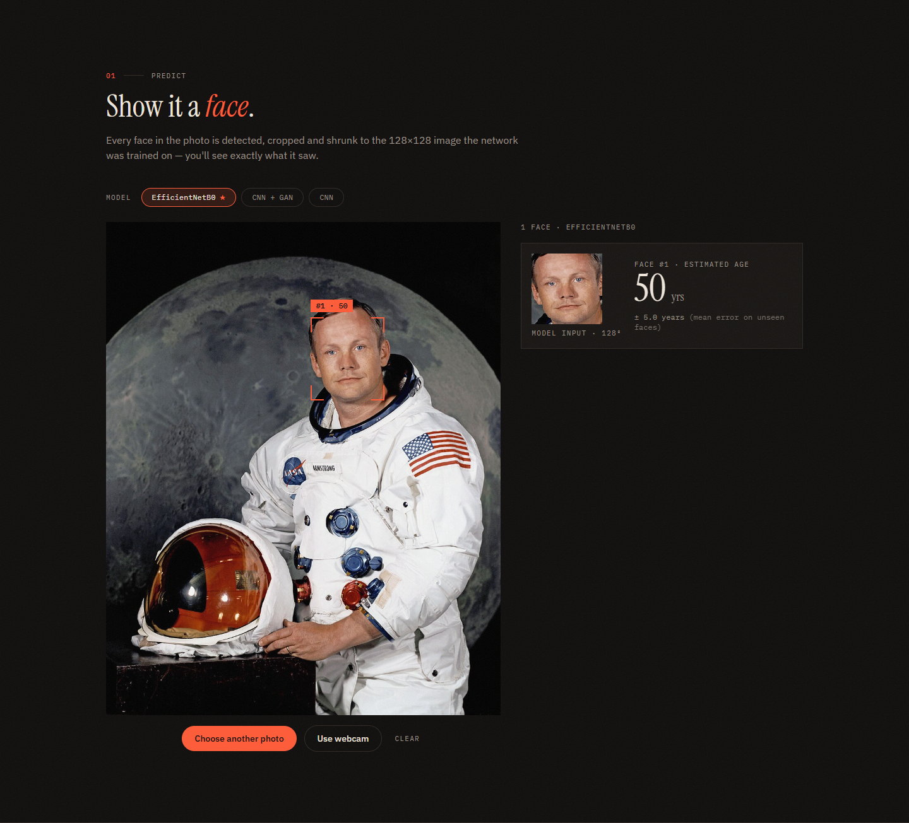
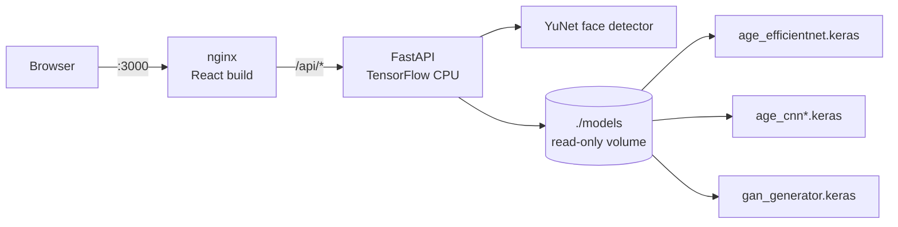
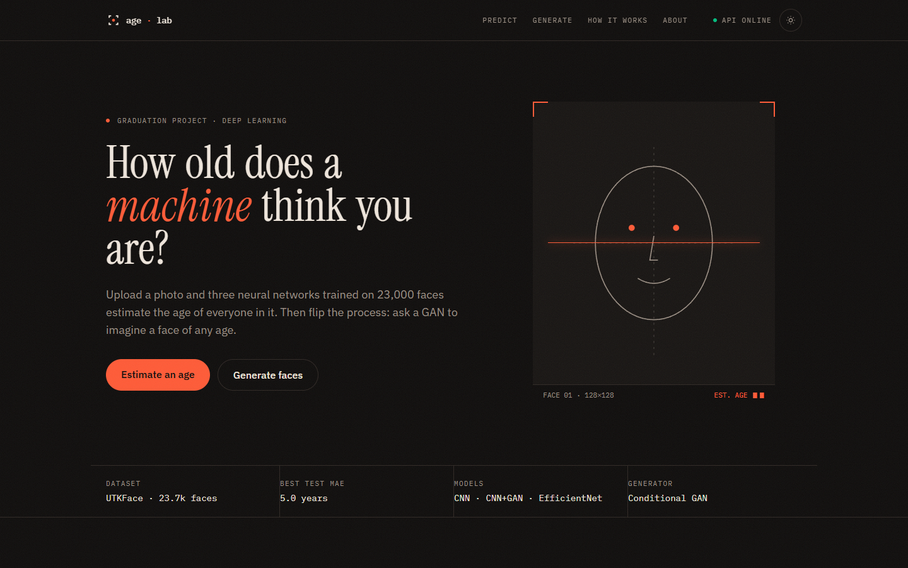
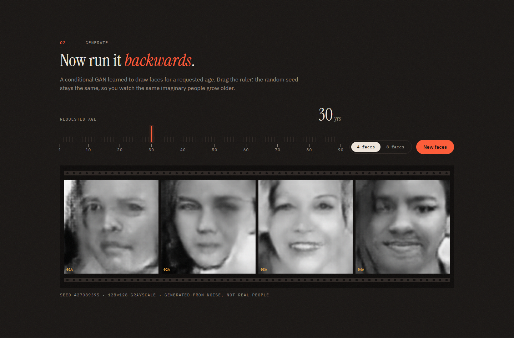
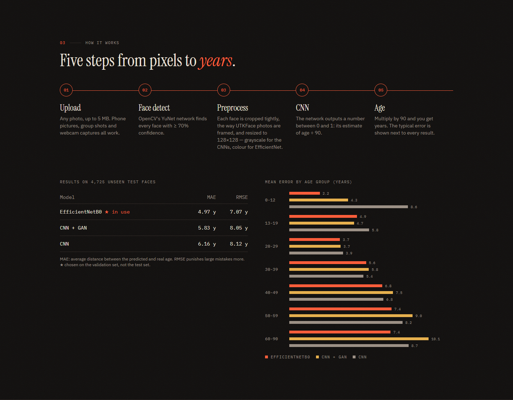
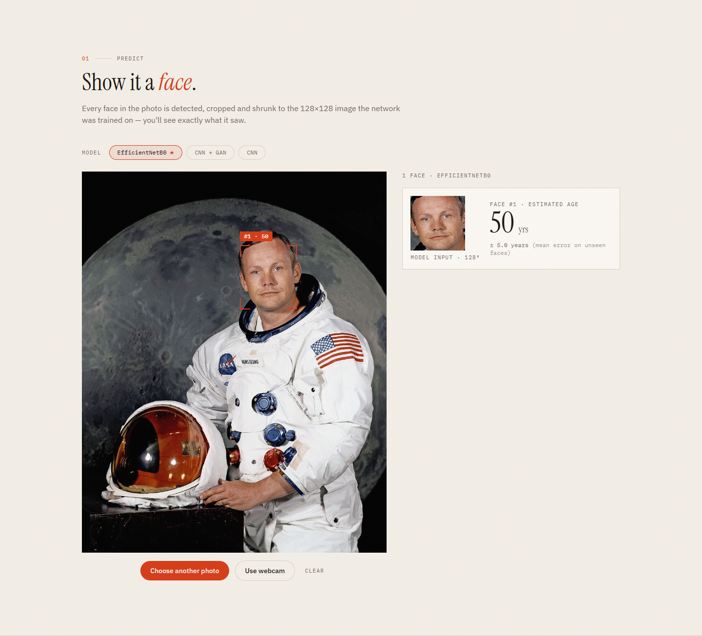
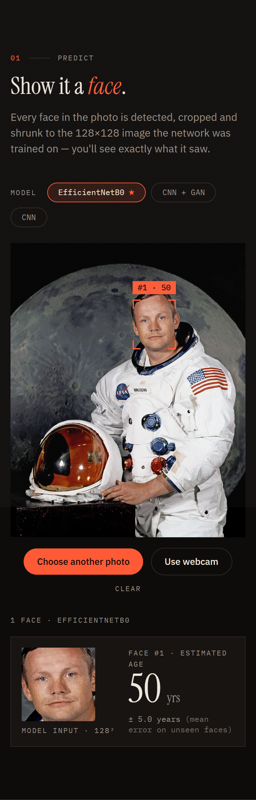

# Deep Age Estimator

Estimate a person's age from a face photo, and generate faces of any age with a conditional GAN.
Graduation project by **Ayham Ayan**: a training notebook plus a full web app (FastAPI + React, packaged with Docker).



## Results

Three models were trained on [UTKFace](https://susanqq.github.io/UTKFace/) (ages 0–90, 23,621 images: 17,006 train,
1,890 validation, 4,725 test). All numbers are on the same held-out test set.

| Model | Input | Test MAE | Test RMSE |
|---|---|---|---|
| CNN | 128×128 grayscale | 6.16 years | 8.12 |
| CNN + GAN augmentation | 128×128 grayscale | 5.83 years | 8.05 |
| **EfficientNetB0** (transfer learning) | 128×128 RGB | **4.97 years** | **7.07** |

The first version of the notebook reached 6.3 years. Faces added by the conditional GAN improve the same CNN by 0.33 years;
the web app uses EfficientNetB0 by default, the best model on the validation set.

MAE by age group (years):

| Model | 0–12 | 13–19 | 20–29 | 30–39 | 40–49 | 50–59 | 60–90 |
|---|---|---|---|---|---|---|---|
| CNN | 8.63 | 5.81 | 3.91 | 5.40 | 6.85 | 8.24 | 8.68 |
| CNN + GAN | 4.28 | 4.71 | 3.74 | 5.79 | 7.55 | 8.98 | 10.14 |
| EfficientNetB0 | 2.22 | 4.92 | 3.69 | 5.59 | 6.76 | 7.44 | 7.37 |

> **Photos from outside the dataset are harder.** On four official portraits with known ages (studio lighting, unlike
> UTKFace's mostly casual photos) EfficientNetB0 was off by 11 years on average. The test MAE describes UTKFace-like photos.

## Architecture



```
├── gradute_preoject.ipynb   # training: data, 3 models, GAN, evaluation, export
├── backend/                 # FastAPI app, tests, Dockerfile
│   └── app/
│       ├── routers/         # health, predict, generate, model-info
│       ├── services/        # preprocessing (mirrors the notebook) and model registry
│       └── assets/          # YuNet face detector (ONNX, 230 KB)
├── frontend/                # React + Vite + TypeScript + Tailwind + Motion, nginx config
├── models/                  # trained weights (not in git, see models/README.md)
└── docker-compose.yml
```

**Prediction pipeline** (identical in the notebook and the API):
1. Detect faces with OpenCV's YuNet (score ≥ 0.7).
2. Crop each face with margins of 9% left, 0% top, 8% right and 2% bottom of the detected box. These were measured by
   running YuNet on 1,000 UTKFace images, so uploaded photos are framed like the training images.
3. Resize to 128×128 (grayscale for the CNNs, RGB for EfficientNet). Pixels stay in 0–255; each model rescales internally.
4. Age = model output × 90.

## Run it with Docker

1. Put the trained models in `models/` (see [models/README.md](models/README.md)). Running the last cells of the
   notebook copies them there along with `metrics.json`.
2. Start the app:
   ```bash
   docker compose up --build
   ```
3. Open http://localhost:3000.

The backend loads all models once at startup (about 20 s) and the frontend waits for it to be healthy.
Only port 3000 is published; the API is reached through nginx at `/api`. Missing models are reported by
`/api/health` and the matching feature is disabled in the UI instead of failing.

## Local development

```bash
# Backend (Python 3.11+)
cd backend
pip install -r requirements-dev.txt
cp .env.example .env            # MODELS_DIR=../models by default
uvicorn app.main:app --reload   # http://localhost:8000/api/docs
pytest                          # 27 tests; the real-model test runs when ./models has weights

# Frontend (Node 20+)
cd frontend
npm install
npm run dev                     # http://localhost:5173, /api is proxied to :8000
```

| Variable | Default | Meaning |
|---|---|---|
| `MODELS_DIR` | `../models` (`/models` in Docker) | Folder with the `.keras` files and `metrics.json` |
| `CORS_ORIGINS` | `http://localhost:5173` | Comma-separated origins, only needed when the browser calls the API directly |
| `MAX_UPLOAD_MB` | `5` | Upload size limit |
| `DEFAULT_MODEL` | best by validation MAE | `cnn`, `cnn_gan` or `efficientnet` |
| `VITE_API_BASE` (frontend, build time) | empty | API origin; empty means same origin |

## API

Interactive docs: `/api/docs`.

| Method | Path | Description |
|---|---|---|
| `GET` | `/api/health` | Status and which models are loaded |
| `POST` | `/api/predict?model=` | Multipart `file` (image, ≤ 5 MB). Returns every detected face |
| `POST` | `/api/generate` | `{"age": 1–90, "count": 1–8, "seed"?: int}` → GAN faces |
| `GET` | `/api/model-info` | Dataset, preprocessing steps, metrics per model |

Errors: `400` undecodable image or unknown model, `413` file too large, `415` not an image, `422` no face detected,
`503` model not loaded.

```bash
curl -F "file=@backend/tests/data/face.jpg;type=image/jpeg" http://localhost:3000/api/predict
```
```json
{
  "model": "efficientnet",
  "image_width": 960,
  "image_height": 1200,
  "faces": [
    {
      "bbox": { "x": 498, "y": 231, "w": 179, "h": 203 },
      "age": 49.6,
      "crop": "iVBORw0KGgoAAAANSUhEUgAAAIAAAACACAIAAABMXPac..."
    }
  ]
}
```
`bbox` is in original image pixels; `crop` is a base64 PNG of the exact 128×128 image the model received.

## Screenshots

| | |
|---|---|
|  |  |
|  |  |



## Training

Open `gradute_preoject.ipynb`, set `UTKFACE_DIR` (or put the `UTKFace` folder next to the notebook) and run all cells.
On an RTX 3050 Laptop GPU a full run takes about 2.5 hours (CNN ~25 min, GAN ~25 min, CNN + GAN ~25 min,
EfficientNetB0 ~70 min). The project report is
[التنبؤ بعمر االنسان باستخدام التعلم العميق.pdf](التنبؤ%20بعمر%20االنسان%20باستخدام%20التعلم%20العميق.pdf).

The test photo `backend/tests/data/face.jpg` is NASA's 1969 portrait of Neil Armstrong (public domain).
